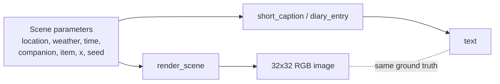
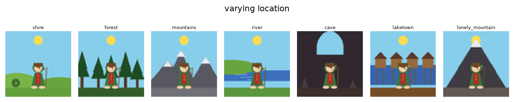
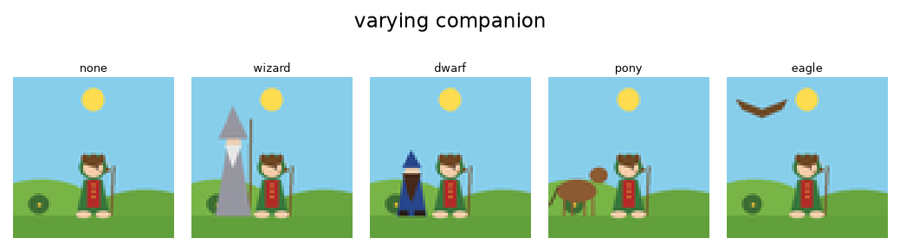
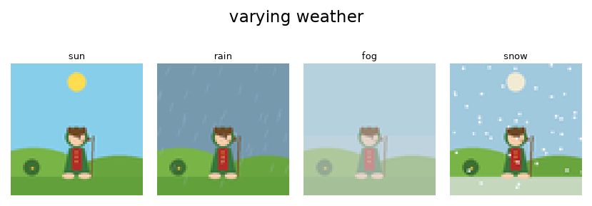
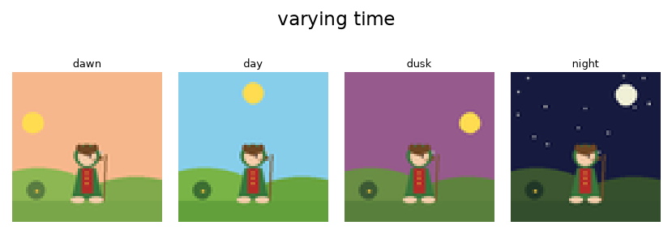
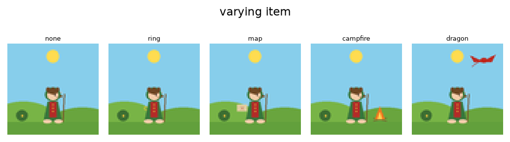
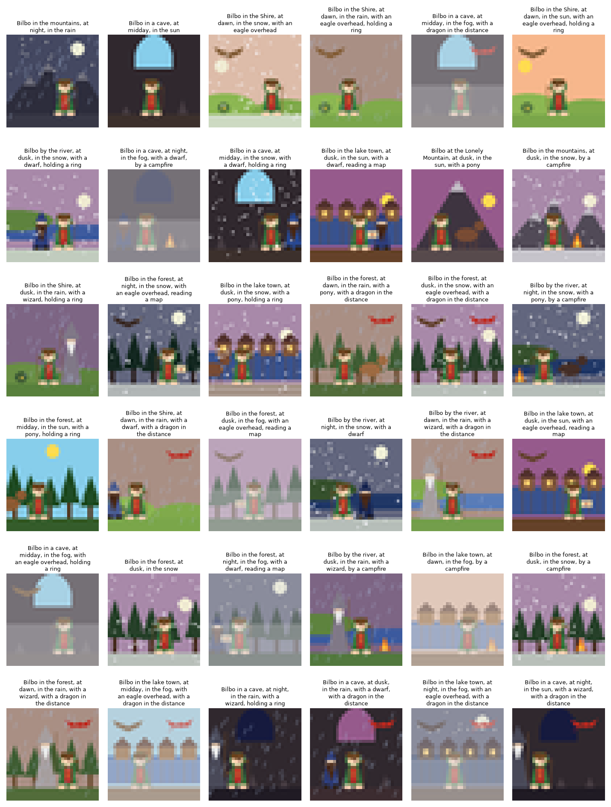
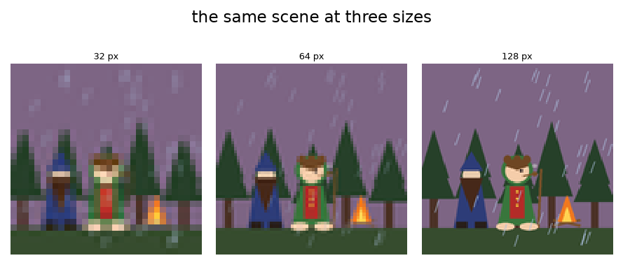

# Phase 0: Skeleton and scenario

## 1. The question this phase answers

What do we need in place before a single gradient is computed? Three things: a repeatable
environment, the rules every chapter follows, and the story that all later phases share. This
phase builds the tooling, writes the [conventions](../00-conventions.md), and introduces Bilbo's
world: the renderer and caption generator that will feed every model from Phase 2 to Phase 10.

On the road to the illustrated diary, this is the first page: we can draw Bilbo and describe the
picture in words, and both come from the same set of parameters.

## 2. Fundamentals

There is no deep learning in this chapter, but there are two ideas the rest of the project depends
on.

**Controlled data.** Real datasets are messy: nobody knows exactly which pixels make a photograph
"a dog at the beach". Ours is the opposite. Every image is produced from a handful of categorical
**attributes** (location, weather, time of day, companion, item), a horizontal position, and a
seed. That means every question later in the project has a ground-truth answer. Did the model bind
the word "rain" to the rain attribute? Did the LoRA change Bilbo or only the scene? We can always
check, because we know exactly what varied.

**Determinism.** A **seed** fixes the state of a random number generator, so the same seed gives
the same sequence of "random" numbers. The renderer takes a seed per scene, the training utilities
seed Python, NumPy, and PyTorch together, and every experiment records its seed. When a result
looks surprising, the first question is always "does it reproduce?", and that question only has an
answer if the run can be repeated exactly.

## 3. What we built

**Tooling.** [`pyproject.toml`](../../pyproject.toml) is managed by `uv`. Core dependencies are
PyTorch, torchvision, NumPy, Matplotlib, and Pillow. The production libraries used for comparisons
(`transformers`, `diffusers`, `peft`, and friends) sit in an optional `library` extra so the core
install stays small and `src/dl` can never import them by accident. `pytest` and `ruff` are the
only development tools.

**Training utilities.** [`get_device`](../../src/dl/training/device.py) picks Apple's Metal backend
when it is available and falls back to CPU. [`seed_everything`](../../src/dl/training/seed.py)
seeds every generator at once.

**The scenario.** [`scenario.py`](../../src/dl/world/scenario.py) defines Bilbo as a palette and a
height, the five attributes with their vocabularies, a `Scene` dataclass that validates its values
and produces integer labels, and the stages of the journey that Phase 10 will walk.

**The renderer.** [`render.py`](../../src/dl/world/render.py) draws a scene with Pillow. All
coordinates are fractions of the canvas, so the same code produces 32, 64, or 128 pixel images.
Drawing happens at four times the target size and is shrunk with a Lanczos filter, which is why
edges look smooth at 32 pixels instead of jagged (**supersampling**). Bilbo is drawn last so he is
always in front, and his shape and colors never depend on the scene.

**Captions.** [`captions.py`](../../src/dl/world/captions.py) produces two texts per scene. The
`short_caption` is one clause per attribute and fully deterministic ("Bilbo in the forest, at dusk,
in the rain, with a dwarf, by a campfire"); it will condition the image models. The `diary_entry`
picks among templates in Bilbo's voice and adds a mood sentence derived from the scene; it feeds the
language models from Phase 4 on.

**The dataset helper.** [`dataset.py`](../../src/dl/world/dataset.py) generates a reproducible
list of scenes, images, and both texts from a seed.

## 4. Experiments and results

| Check | Result |
|---|---|
| `uv run pytest` | 25 tests pass (Phase 0 and Phase 1 together) |
| `uv run ruff check` | clean |
| Device selected by `get_device()` | `mps` |
| Seeded tensor identical across two runs | yes |
| Attribute values that render a non-flat image | all 25 |
| Captions name every attribute of 50 random scenes | yes |

Sample entries are in [sample_entries.md](../../experiments/p00_skeleton/sample_entries.md).

## 5. What went wrong and what surprised me

- Hatchling refused to build the package until a README existed, because `pyproject.toml` pointed
  at one. Tooling errors come first in every project.
- A first draft placed the pony's head where Bilbo stands. The fix was a wider offset for the pony
  only; the lesson is that every companion needs a quick visual check, not only a shape test.
- Template captions are dull to read, and that is fine. Their job is to be checkable, and dullness
  is the price of a guaranteed link between words and pixels.

## 6. The library equivalent

There is no model yet, so the library counterparts here are about tooling and data.

| Ours | Production equivalent | Notes |
|---|---|---|
| `uv` with `pyproject.toml` | `pip` + `venv`, `conda`, `poetry` | `uv` resolves and installs far faster and pins a lockfile; the project only needs one environment. |
| `pytest` | `unittest` | `pytest` needs less boilerplate and its fixtures scale to later phases. |
| `ruff` | `flake8` + `black` + `isort` | One tool, one config, both lint and format. |
| `render_scene` with Pillow | `torchvision.datasets` (MNIST, CIFAR-10) | Real datasets arrive in Phase 2 for benchmarks; our synthetic set is the one with known ground truth. |
| `generate_examples` | `torch.utils.data.Dataset` | Phase 2 wraps our generator in a `Dataset` so it can be batched by a `DataLoader`. |

## 7. Exit criteria

- [x] `uv run pytest` passes.
- [x] `uv run ruff check` passes.
- [x] A script prints the selected device and a seeded tensor that is identical across runs.
- [x] A figure shows a 6x6 grid of rendered diary scenes with their captions.
- [x] Every attribute value renders and is named in the caption.

## 8. Further reading

- [uv documentation](https://docs.astral.sh/uv/): the environment and dependency manager used throughout.
- [Pillow ImageDraw reference](https://pillow.readthedocs.io/en/stable/reference/ImageDraw.html): every primitive the renderer uses.
- [PyTorch MPS backend notes](https://pytorch.org/docs/stable/notes/mps.html): what the Metal backend supports and where it falls back to CPU.
- [PyTorch reproducibility notes](https://pytorch.org/docs/stable/notes/randomness.html): why seeding is necessary but not always sufficient, a theme that returns in Phase 10.

## 9. Glossary additions

Attribute, supersampling, seed. See [glossary.md](../glossary.md).
