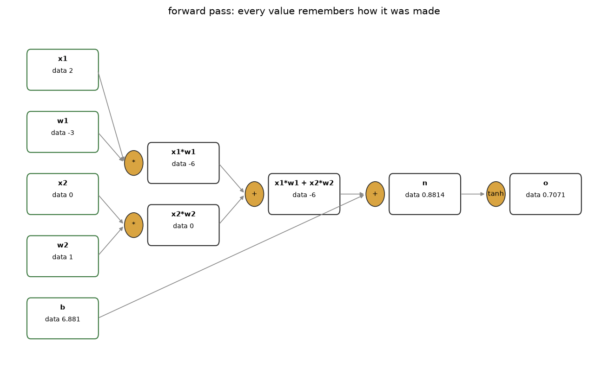
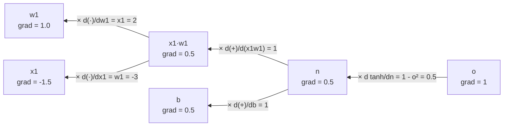
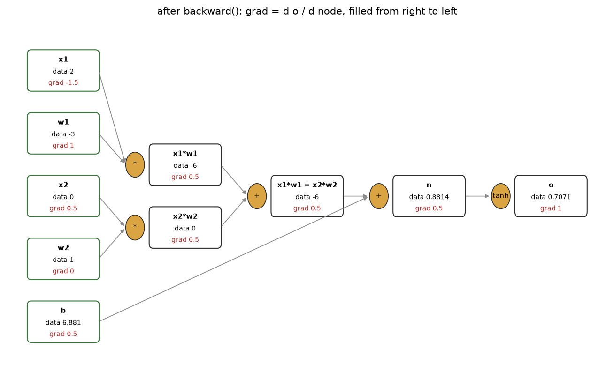
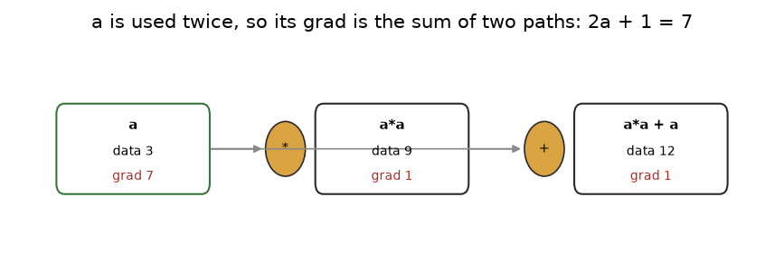
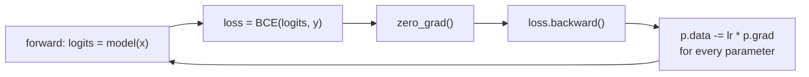
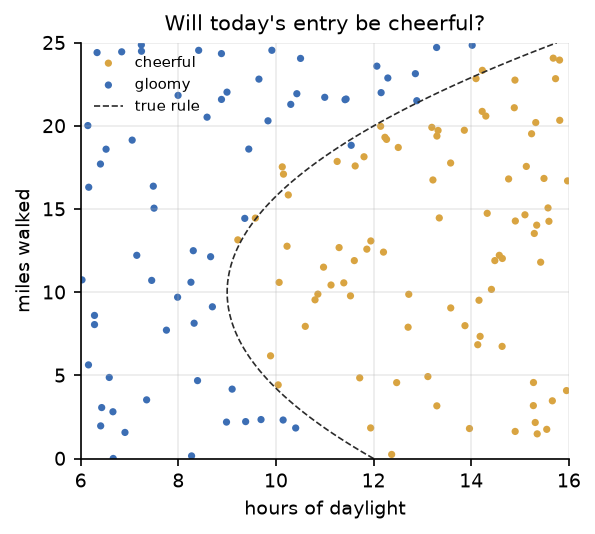
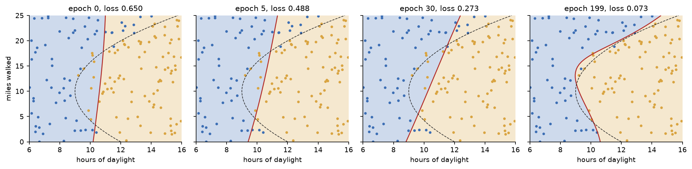
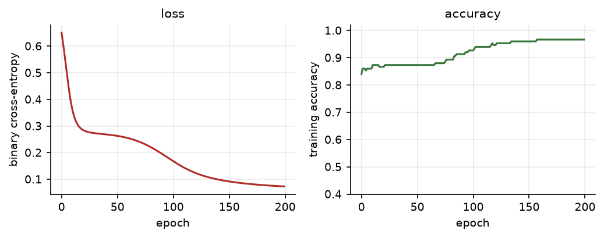
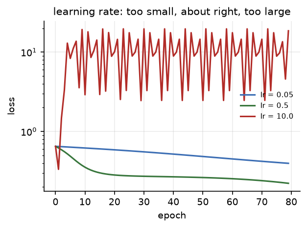
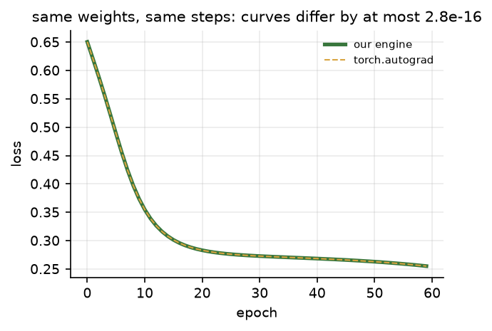

# Phase 1: Autograd from scratch

## 1. The question this phase answers

How does a neural network learn? Concretely: given a loss that says how wrong the network is, how do
we find out which direction to nudge each of its weights? The answer is **backpropagation**, and
the machinery that performs it automatically is **autograd**. This chapter builds one in about 150
lines of Python, checks it against finite differences and against PyTorch, and uses it to train a
tiny network on a question from Bilbo's world: given the hours of daylight and the miles walked,
will today's diary entry be cheerful?

On the road to the illustrated diary, this is the engine under everything. Every later model, from
the GPT that writes entries to the U-Net that draws them, is trained by exactly this procedure,
only on tensors instead of scalars.

## 2. Fundamentals

### A model is a function with knobs

A neural network takes an input $x$ and a set of parameters $\theta$ (the weights and biases) and
produces an output $f(x; \theta)$. A **loss** $L(\theta)$ is one number that measures how far the
outputs are from the targets over a batch of examples. Training means finding $\theta$ that makes
$L$ small.

**Gradient descent** does that by repeating one step: compute the **gradient**
$\nabla_\theta L$, the vector of partial derivatives $\partial L / \partial \theta_i$, and move
every parameter a little against it:

$$\theta_i \leftarrow \theta_i - \eta \, \frac{\partial L}{\partial \theta_i}$$

The gradient points in the direction that increases $L$ fastest, so stepping against it decreases
$L$. The step size $\eta$ is the **learning rate**. That is the whole algorithm; the hard part is
computing thousands (later, millions) of partial derivatives cheaply.

### The computational graph

Any computation built from simple operations can be drawn as a graph. Here is one neuron: two
inputs, two weights, a bias, and a tanh.

Each box is a value. Each circle is the operation that produced it, with arrows from its inputs.
Reading left to right is the **forward pass**: $x_1 w_1 = -6$, $x_2 w_2 = 0$, their sum plus the
bias is $n = 0.8814$, and $o = \tanh(n) = 0.7071$.

The key observation: every operation in the graph is simple enough that we know its derivative
with respect to each input by hand. For $c = a \cdot b$, $\partial c / \partial a = b$. For
$c = \tanh(a)$, $\partial c / \partial a = 1 - c^2$. These are **local derivatives**: they only
involve the node and its immediate inputs.

### The chain rule as message passing

We want $\partial o / \partial w_1$, but $w_1$ is three operations away from $o$. The **chain
rule** connects them: if $o$ depends on $n$, and $n$ depends on $w_1$, then

$$\frac{\partial o}{\partial w_1} = \frac{\partial o}{\partial n} \cdot \frac{\partial n}{\partial w_1}.$$

Applied along the whole graph this says: the gradient at any node equals the gradient at the node
that consumed it, times the local derivative of that consuming operation. So gradients can be
computed by starting at the output, where $\partial o / \partial o = 1$, and walking backward,
each node multiplying the gradient it received by its local derivative and passing the result to
its inputs.

That walk is **backpropagation**. Here is the same graph after it runs, with every node's gradient
filled in (in red):

Check one by hand: $\partial o / \partial w_1 = 0.5 \cdot 1 \cdot x_1 = 0.5 \cdot 2 = 1.0$, which
matches the figure. And $\partial o / \partial w_2 = 0.5 \cdot x_2 = 0$: because $x_2 = 0$, changing
$w_2$ does nothing to the output, and the gradient says so.

### Two details that matter

**Gradients accumulate.** If a value is used twice, it receives gradient from two paths, and the
chain rule says they add. For $c = a \cdot a + a$ the two paths give $2a$ and $1$; at $a = 3$ the
gradient is 7. This is why every backward function uses `+=` and why gradients must be zeroed
before each new backward pass.

**Order matters.** A node's gradient is only complete once every node that consumed it has passed
its contribution back. Visiting nodes in reverse **topological order** (every node after all the
nodes that depend on it) guarantees this. The engine computes that order with a depth-first walk
and then iterates it backward.

### Why we need a nonlinearity

Without the tanh, a neuron is a weighted sum, and stacking weighted sums gives another weighted
sum: a network of any depth would collapse to a single straight-line boundary. The **activation
function** is what lets a stack of layers represent curves. Below, watch the boundary stay a line
for the first thirty epochs and then bend.

### Checking the gradients

Backward functions are easy to get subtly wrong, and a wrong gradient does not crash: training
just quietly works worse. The independent check is **finite differences**: for any parameter,
nudge it by a tiny $\epsilon$ in both directions and compute

$$\frac{\partial L}{\partial \theta_i} \approx \frac{L(\theta_i + \epsilon) - L(\theta_i - \epsilon)}{2\epsilon}.$$

This is far too slow for training (two forward passes per parameter) but it involves no backward
code, so if it agrees with autograd, autograd is right.

## 3. What we built

The engine lives in [`src/dl/autograd/`](../../src/dl/autograd). PyTorch is not imported anywhere
in it.

- [`engine.py`](../../src/dl/autograd/engine.py): the `Value` class. Each `Value` holds `data`,
  `grad`, the tuple of values it was made from (`_prev`), and a `_backward` closure that pushes
  gradient to them. Primitive operations are `+`, `*`, `**` (constant exponent), `tanh`, `relu`,
  `sigmoid`, `softplus`, `exp`, `log`. Subtraction, division, and negation are derived from these,
  so they need no backward code of their own. `backward()` computes the topological order, sets the
  output's gradient to 1, and calls every `_backward` in reverse.
- [`nn.py`](../../src/dl/autograd/nn.py): `Neuron` (weighted sum plus bias plus optional
  nonlinearity), `Layer` (a list of neurons), and `MLP` (layers stacked, last one linear). Weights
  are initialized uniformly in $[-1, 1]$ scaled by $1/\sqrt{n_\text{in}}$ so a neuron's
  pre-activation stays near unit size no matter how many inputs it has.
- [`losses.py`](../../src/dl/autograd/losses.py): mean squared error, hinge loss, and binary
  cross-entropy with logits.
- [`check.py`](../../src/dl/autograd/check.py): `finite_difference_grads` and `check_gradients`.
- [`draw.py`](../../src/dl/autograd/draw.py): draws a `Value` graph with Matplotlib; the graph
  figures in this chapter come from it.

The training loop in [`train_mood.py`](../../experiments/p01_autograd/train_mood.py) is five lines,
and every later phase's loop has the same shape:

Model: `MLP(2, [8, 8, 1])` with tanh, which is $2 \cdot 8 + 8 = 24$, plus $8 \cdot 8 + 8 = 72$,
plus $8 + 1 = 9$, for 105 parameters. Inputs are standardized to zero mean and unit variance
first; without that, "miles walked" (0 to 25) would dominate "hours of daylight" (6 to 16) purely
because of its units.

## 4. Experiments and results

The dataset comes from [`toy.py`](../../src/dl/world/toy.py): 150 training days and 200 test
days, each with hours of daylight and miles walked. The rule that makes a day cheerful is a
parabola (Bilbo is happiest around ten miles and needs a longer day to stay cheerful if he walks
much more or much less), plus a little noise so the classes overlap near the boundary.

Numbers below are from [results.md](../../experiments/p01_autograd/results.md).

| Setting | Value |
|---|---|
| Model | MLP 2 → 8 → 8 → 1, tanh |
| Parameters | 105 |
| Optimizer | full-batch gradient descent, lr 0.5, 200 epochs |
| Loss | binary cross-entropy with logits |
| Final training loss | 0.073 |
| Training accuracy | 96.7% |
| Test accuracy (200 unseen days) | 96.0% |
| Training time (pure Python, one core) | 29 s |
| Gradient check, worst absolute error vs finite differences | 5.1e-12 |

The decision boundary starts as a straight line and stays one for about thirty epochs, then bends
to follow the parabola:

The loss curve shows the same story as a plateau. Between roughly epoch 20 and 70 the loss barely
moves while the network is still, in effect, a linear classifier. Then the hidden layers find the
curve and the loss drops again.

The learning rate decides everything about that curve. Three runs from the same initialization,
80 epochs each, final losses 0.397, 0.222, and 18.6:

At 0.05 the model is still slowly improving when the budget runs out. At 0.5 it converges. At 10
each step overshoots the minimum so badly that the loss explodes and oscillates for the rest of
training; the network never recovers.

## 5. What went wrong and what surprised me

- **The loss crashed with log(0).** The first binary cross-entropy computed `sigmoid(z)` and then
  `log(1 - p)`. For $z$ above about 37 in double precision, the sigmoid rounds to exactly 1.0, and
  the log of zero raised an error. This appeared as soon as a large learning rate pushed logits
  into the tens. The fix is algebra, not a clamp: $-\log(1 - \sigma(z)) = \text{softplus}(z)$ and
  $-\log \sigma(z) = \text{softplus}(-z)$, where $\text{softplus}(x) = \log(1 + e^x)$ can be
  computed as $\max(x, 0) + \log(1 + e^{-|x|})$ without ever overflowing. This is exactly why
  PyTorch has `binary_cross_entropy_with_logits` as a separate function from `sigmoid` followed by
  `binary_cross_entropy`. The `softplus` primitive was added to the engine for this.
- **Label noise caps accuracy.** The first dataset used a noise level at which about 6% of points
  near the boundary carry the "wrong" label. No model can beat that, and the 95% exit criterion was
  unreachable. The noise was lowered so the noiseless rule scores 97.5% on the test set, and the
  network reaches 96%. Lesson: before judging a model, ask what the best possible score on the
  data is.
- **The plateau looked like a bug.** For fifty epochs the loss sat at 0.27 and I suspected a
  gradient error. The gradient check said otherwise. The network was simply in a region where the
  linear solution is a local resting point; patience, not a fix, was the answer.
- **A large learning rate did not fail the way I expected.** At lr 3.0 the model trained fine and
  even reached a lower loss than lr 0.5 in the same number of epochs. Standardized inputs and a
  tiny network are forgiving. It took lr 10 to make divergence visible.

## 6. The library equivalent: `torch.autograd`

PyTorch does what our engine does, on tensors instead of scalars and in C++. The correspondence is
close enough to map line by line.

| Ours | PyTorch | Notes |
|---|---|---|
| `Value(2.0)` | `torch.tensor(2.0, requires_grad=True)` | Leaf that wants a gradient. Tensors default to `requires_grad=False`; ours always track. |
| `v.data`, `v.grad` | `t.data` or `t.item()`, `t.grad` | Same names. `t.grad` is `None` until the first backward. |
| `v._prev`, `v._backward` | `t.grad_fn`, `t.grad_fn.next_functions` | A `MulBackward0` object is our closure plus pointers to its inputs. |
| `v._op` | `type(t.grad_fn).__name__` | `MulBackward0`, `TanhBackward0`, ... |
| `out.backward()` | `out.backward()` | Identical call. PyTorch frees the graph afterward unless `retain_graph=True`. |
| `model.zero_grad()` | `optimizer.zero_grad()` or `model.zero_grad()` | Same reason: gradients accumulate. |
| `check_gradients(f, params)` | `torch.autograd.gradcheck(f, inputs)` | Same finite-difference idea; PyTorch's wants double precision. |
| `p.data -= lr * p.grad` | `torch.optim.SGD(params, lr).step()` | Phase 2 replaces the loop with an optimizer object. |
| (no equivalent) | `with torch.no_grad():`, `t.detach()` | Turn off graph recording for evaluation or for the update step itself. |

What PyTorch adds that we skipped: tensors (one node carries a whole matrix, so a layer is one
multiply instead of thousands of scalar nodes), a C++ kernel per operation, GPU execution, graph
freeing after backward to save memory, higher-order gradients, and hooks. None of these change the
algorithm.

[`library.py`](../../experiments/p01_autograd/library.py) demonstrates the correspondence three
ways. First, the same scalar expression in both engines gives identical gradients to twelve
digits. Second, walking `grad_fn.next_functions` from the output prints the same chain our
`_prev` would: `DivBackward0` → `SubBackward0` → `AddBackward0` → `TanhBackward0` →
`MulBackward0` → `AccumulateGrad`. Third, an `nn.Sequential` with the same architecture is loaded
with our MLP's exact initial weights and trained with the same full-batch steps for 60 epochs:

The two loss curves differ by at most 2.8e-16, which is floating-point rounding. Same weights,
same gradients, same steps.

## 7. Exit criteria

- [x] Gradients match finite differences within 1e-4 on random graphs (worst error 5.1e-12).
- [x] Gradients match `torch.autograd` on the same expression.
- [x] The MLP reaches above 95% on the toy set (96.7% train, 96.0% test).
- [x] Decision-boundary figure, training curves, learning-rate sweep.
- [x] `library.py` runs and its comparison is quoted above.
- [x] `uv run pytest` and `uv run ruff check` pass.

## 8. Further reading

- [Karpathy, The spelled-out intro to neural networks and backpropagation](https://www.youtube.com/watch?v=VMj-3S1tku0): the two-hour video this chapter follows; watch it with the engine open.
- [micrograd](https://github.com/karpathy/micrograd): the 100-line reference our engine extends with `log`, `sigmoid`, `softplus`, and gradient checking.
- [3Blue1Brown, What is backpropagation really doing?](https://www.youtube.com/watch?v=Ilg3gGewQ5U): the visual intuition for why the chain rule along a graph is the right picture.
- [CS231n, Backpropagation, Intuitions](https://cs231n.github.io/optimization-2/): the "gates and local gradients" framing, with worked examples.
- [PyTorch, A Gentle Introduction to torch.autograd](https://pytorch.org/tutorials/beginner/blitz/autograd_tutorial.html) and [Autograd mechanics](https://pytorch.org/docs/stable/notes/autograd.html): the library section's sources.
- [Goodfellow et al., Deep Learning, chapter 6.5](https://www.deeplearningbook.org/contents/mlp.html): backpropagation formally, including the general graph algorithm.

## 9. Glossary additions

Computational graph, gradient, chain rule, backpropagation, autograd, topological order, gradient
descent, learning rate, loss, finite differences, gradient check, neuron, MLP, nonlinearity,
decision boundary, logit, standardization, softplus, numerically stable. See
[glossary.md](../glossary.md).
