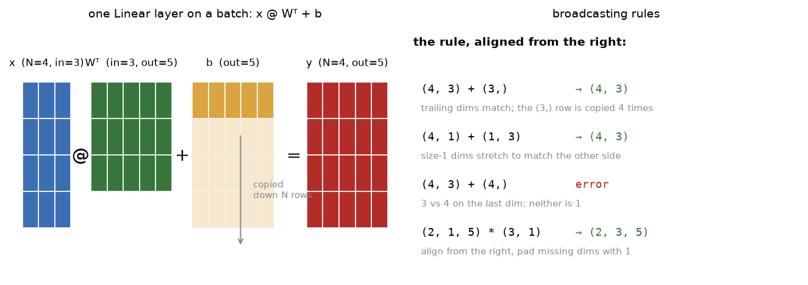
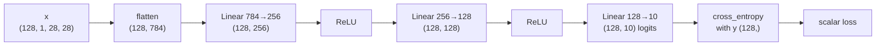
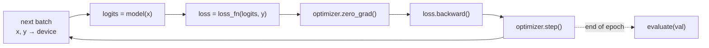
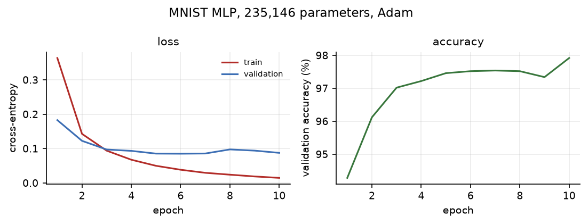
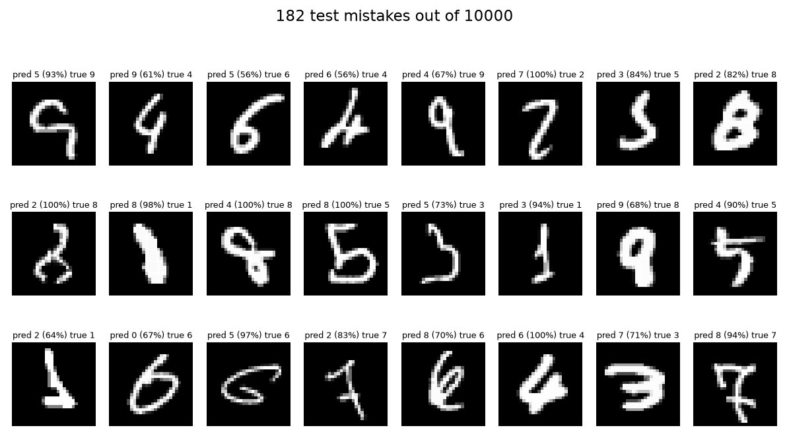
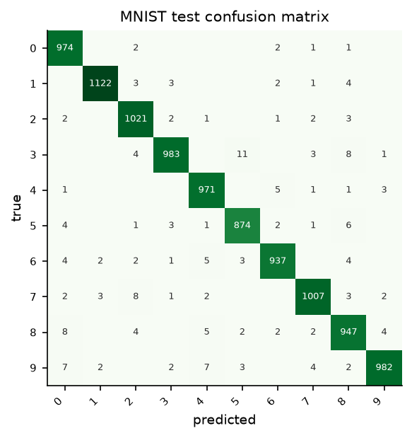
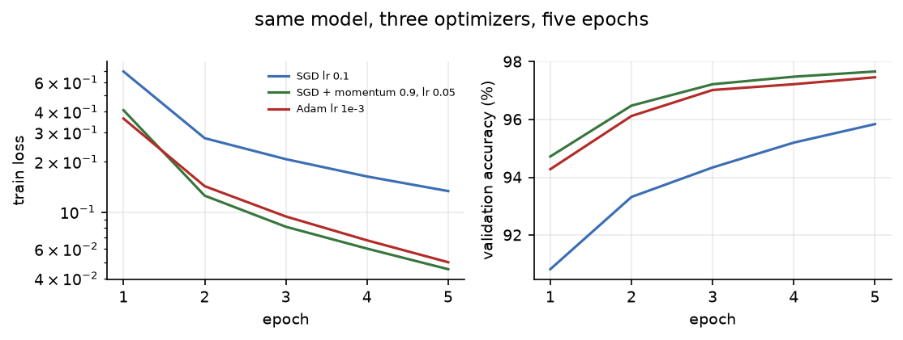
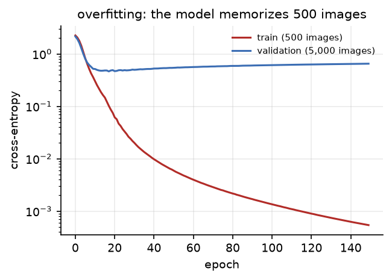
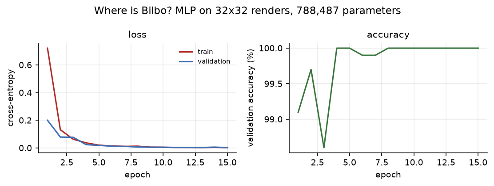
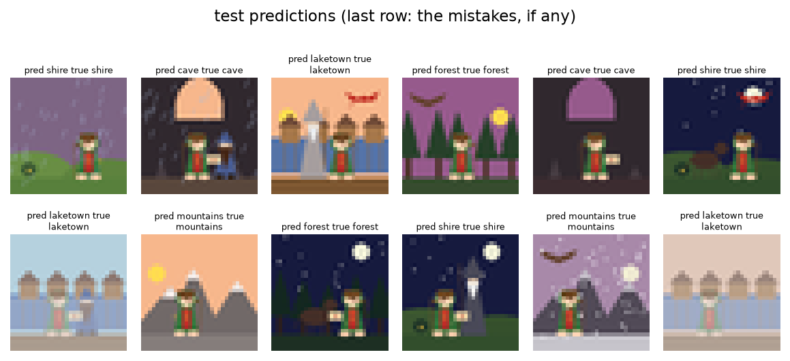

# Phase 2: Tensors and PyTorch

## 1. The question this phase answers

Phase 1 trained 105 parameters on 150 points in 29 seconds of pure Python. Real models have
millions of parameters and see millions of examples. How does the same algorithm scale by a factor
of a million? The answer is **tensors**: instead of one graph node per number, one node per matrix,
so a whole layer applied to a whole batch is a single multiply that runs on the GPU. This chapter
rebuilds the Phase 1 MLP on tensors, proves the two engines agree, and uses the result to classify
handwritten digits and to tell where Bilbo is standing from a 32-pixel picture.

On the road to the illustrated diary, this is the first time a model looks at a render of Bilbo's
world. Everything it gets wrong here tells us what the vision models of Phase 5 must fix.

## 2. Fundamentals

### Tensors: shape, dtype, device

A tensor is an n-dimensional array plus three facts about it. Its **shape** says how many
dimensions it has and how long each one is: a batch of 128 grayscale digits is `(128, 1, 28, 28)`,
meaning 128 images, 1 color channel, 28 rows, 28 columns. Its **dtype** is the number format;
`float32` is the default, `float64` must be asked for, and `int64` holds class labels. Its
**device** is where the memory lives: `cpu`, or `mps` for the Metal GPU on this machine. Two
tensors in one operation must share a device, and the result inherits the dtype of its inputs.

Each fact bit me once this phase (see section 5). Shapes, dtypes, and devices are where most
PyTorch errors come from, and reading them off an error message is the first skill to build.

### One layer is one matrix multiply

In Phase 1 a neuron computed $\sum_i w_i x_i + b$ and a layer was a list of neurons. On tensors,
stack the weight vectors of all `out` neurons into a matrix $W$ of shape `(out, in)`, put a batch
of $N$ inputs into a matrix $X$ of shape `(N, in)`, and the entire layer on the entire batch is

$$Y = X W^\top + b, \qquad Y \in \mathbb{R}^{N \times \text{out}}.$$

The bias $b$ has shape `(out,)` but is added to an `(N, out)` matrix. That works because of
**broadcasting**: PyTorch aligns shapes from the right, and any dimension of size 1 (or missing)
is stretched to match. `(N, out) + (out,)` becomes `(N, out) + (1, out)`, and the bias row is
reused for every example without being copied in memory.

### Batches and epochs

Phase 1 used every example for every step (full-batch gradient descent). With 55,000 images that
would be one slow step per pass. **Minibatch** gradient descent instead takes a random subset,
here 128 images, computes the gradient on that, and steps. The gradient is noisier, but a step
costs 1/430 as much, and 430 noisy steps beat one exact step by a wide margin. One pass over the
data is an **epoch**; the batches are reshuffled each epoch so no two epochs see the same groupings.

### Softmax and cross-entropy

A ten-class classifier outputs ten numbers per image, the **logits** $z$. Softmax turns them into
probabilities:

$$p_i = \frac{e^{z_i}}{\sum_j e^{z_j}}.$$

Every $p_i$ is positive and they sum to one. The loss is the negative log-probability of the
correct class $y$, called **cross-entropy**:

$$L = -\log p_y = -z_y + \log \sum_j e^{z_j}.$$

If the model puts probability 1 on the right answer the loss is 0; if it puts probability 0.01 the
loss is 4.6. This is Phase 1's binary cross-entropy with two classes replaced by ten, and it has
the same numerical trap: $e^{z}$ overflows for $z$ above about 88 in float32. The fix is the
**log-sum-exp trick**: subtract $m = \max_j z_j$ inside both the exponent and the log,
$\log \sum_j e^{z_j} = m + \log \sum_j e^{z_j - m}$, which is exact and never overflows because the
largest exponent is now $e^0 = 1$.

The gradient of cross-entropy with respect to the logits has a form worth memorizing:

$$\frac{\partial L}{\partial z_i} = p_i - \mathbb{1}[i = y].$$

Predicted probability minus the one-hot target. The model is pushed to raise the correct logit by
$(1 - p_y)$ and lower every wrong logit by its own probability. One of the tests in
[test_nn.py](../../tests/test_nn.py) checks this formula against autograd.

### Optimizers

Plain **SGD** is Phase 1's update on a minibatch: $\theta \leftarrow \theta - \eta g$.
**Momentum** keeps a running average of gradients, $v \leftarrow \mu v + g$, and steps along $v$.
Directions that agree from batch to batch build up speed; directions that flip sign cancel. With
$\mu = 0.9$ the effective step in a consistent direction is about ten times larger, which is why
its learning rate is set lower.

**Adam** goes one step further and gives every parameter its own step size. It tracks the mean
gradient $m$ and the mean squared gradient $v$:

$$m \leftarrow \beta_1 m + (1 - \beta_1) g, \qquad v \leftarrow \beta_2 v + (1 - \beta_2) g^2,$$

corrects both for starting at zero by dividing by $(1 - \beta^t)$, and steps
$\theta \leftarrow \theta - \eta \, \hat m / (\sqrt{\hat v} + \epsilon)$. Dividing by $\sqrt{\hat v}$
normalizes the step: a parameter whose gradients are always tiny moves as far as one whose
gradients are large. That is why one learning rate, usually $10^{-3}$, works across layers and
problems, and why Adam is the default optimizer for the rest of this project.

### Three splits and what the loss curve says

The data is cut three ways. The **training set** is what the model learns from. The
**validation set** is held out and evaluated after every epoch; it drives decisions such as when
to stop and which learning rate to use. The **test set** is touched once, at the very end, to
report a number nobody tuned against. MNIST ships a 10,000-image test set; we carve 5,000 of the
60,000 training images off for validation.

Read the two loss curves together. Both falling: the model is learning. Training falling while
validation flattens: the model has learned what generalizes and is starting to memorize. Training
falling while validation rises: **overfitting**, and every further epoch makes the model worse on
new data. Section 4 shows all three regimes.

## 3. What we built

The tensor code lives in three packages, each the tensor version of a Phase 1 file.

- [`dl/nn/linear.py`](../../src/dl/nn/linear.py): `Linear`, the $XW^\top + b$ layer, as a
  subclass of `nn.Module` so PyTorch tracks its two `nn.Parameter`s. Weights start uniform in
  $\pm 1/\sqrt{\text{in}}$, the Phase 1 rule; biases start at zero.
- [`dl/nn/functional.py`](../../src/dl/nn/functional.py): `log_softmax` with the max-subtraction
  trick, `softmax`, `cross_entropy`, `accuracy`.
- [`dl/nn/mlp.py`](../../src/dl/nn/mlp.py): `MLP`, which flattens its input and stacks `Linear`
  layers with ReLU or tanh between them.
- [`dl/training/optim.py`](../../src/dl/training/optim.py): `SGD` (with momentum) and `Adam`,
  written out as above, with the same `zero_grad` / `step` interface as `torch.optim`.
- [`dl/training/loop.py`](../../src/dl/training/loop.py): `fit` and `evaluate`, the generic loop
  every later phase uses. It moves batches to the device, records per-epoch train loss,
  validation loss and accuracy, and timing, and knows nothing about the model or the data.
- [`dl/data/batches.py`](../../src/dl/data/batches.py): `Batches`, which slices in-memory tensors
  into shuffled minibatches, and `split`. [`mnist.py`](../../src/dl/data/mnist.py) loads MNIST as
  tensors; [`diary.py`](../../src/dl/data/diary.py) renders 8,000 diary scenes once and caches
  them (95 MB) so experiments start instantly.

The training loop, in full:

## 4. Experiments and results

All numbers are from [results.md](../../experiments/p02_mlp/results.md).

### The two engines agree

[`compare_engines.py`](../../experiments/p02_mlp/compare_engines.py) loads the Phase 1 scalar
MLP's 105 weights into the tensor `MLP`, runs both on the same 150 mood examples in float64, and
compares. The losses are identical to the last digit and the largest gradient difference over all
105 parameters is 4e-17. The scalar engine created 29,680 graph nodes for that forward pass; the
tensor engine created about ten.

### MNIST

| Setting | Value |
|---|---|
| Model | MLP 784 → 256 → 128 → 10, ReLU |
| Parameters | 235,146 |
| Data | 55,000 train / 5,000 validation / 10,000 test |
| Optimizer | Adam, lr 1e-3, batch 128, 10 epochs |
| Test accuracy | 98.18% (182 mistakes) |
| Time per epoch on Metal | 0.65 s |

Training loss keeps falling to the end; validation loss stops improving around epoch 5 and drifts.
The model is beginning to memorize, and a longer run would not help. Ten epochs took under seven
seconds, against 29 seconds for 105 parameters in Phase 1.

Most of the 182 mistakes are digits a person might also hesitate over, and the model is often
unsure about them (56%, 61%). Several are confident and wrong, which is the failure mode to
remember: a probability from a softmax is a statement about the training distribution, not a
guarantee.

The confusions are the expected ones: 3 with 5, 4 with 9, 7 with 2.

### Three optimizers

Same model, same initialization, same batches, five epochs:

| Optimizer | Validation loss | Validation accuracy |
|---|---|---|
| SGD, lr 0.1 | 0.134 | 95.8% |
| SGD with momentum 0.9, lr 0.05 | 0.084 | 97.7% |
| Adam, lr 1e-3 | 0.085 | 97.5% |

Momentum and Adam are neck and neck and both far ahead of plain SGD. Adam's advantage is not
speed on this problem but that its learning rate did not need tuning; 1e-3 is the value that
works nearly everywhere.

### Overfitting on purpose

Train on 500 images for 150 epochs and validate on 5,000:

Training loss falls to 0.0005 and the model classifies its 500 images perfectly. Validation loss
bottoms out at epoch 18 and then climbs to 0.65 as the model trades general features for memorized
pixels. This is the curve to recognize. The cure is more data, a smaller model, regularization, or
stopping at epoch 18.

### Where is Bilbo?

The same recipe on 8,000 diary renders at 32x32 (6,000 / 1,000 / 1,000 split), input dimension
$3 \times 32 \times 32 = 3072$, one hidden layer of 256:

Location is solved: 100% on the test set by epoch 4. It should be. Each location paints most of
the image a distinctive color, so a flat vector of pixels carries the answer directly. The
interesting result is what happens when the same model is asked about the other attributes:

| Attribute | Classes | Chance | Test accuracy |
|---|---|---|---|
| location | 7 | 14% | 100% |
| time | 4 | 25% | 100% |
| weather | 4 | 25% | 94.2% |
| companion | 5 | 20% | 71.3% |
| item | 5 | 20% | 67.8% |

Time of day is the sky color: solved. Weather is mostly sky color plus scattered dots: nearly
solved. Companions and items are small objects that appear at different positions, and the MLP
gets a third of them wrong. A fully connected layer has a separate weight for every pixel, so a
dwarf at pixel (10, 24) and the same dwarf at pixel (20, 24) are, to it, unrelated patterns that
must be learned separately. Phase 5's convolutional networks exist to fix exactly this.

## 5. What went wrong and what surprised me

- **A silent float32.** The first engine comparison agreed to only 7e-9, not 1e-16. The cause was
  `torch.tensor([list of Python floats])`, which produces float32 by default even inside a float64
  model; the weights were rounded before they were copied. Passing `dtype=torch.float64` made the
  gap zero. The general rule: when precision matters, state the dtype.
- **Optimizer state on the wrong device.** The first MNIST run crashed with "found two devices,
  mps:0 and cpu". My `Adam` allocated its moment tensors in `__init__`, while the model was still
  on the CPU; `fit` moved the model to Metal afterward and the update mixed devices. `torch.optim`
  avoids this by creating state lazily on the first `step`, and ours now does the same.
- **The `data/` ignore pattern swallowed a package.** `.gitignore` had `data/`, which matches any
  directory named data, including `src/dl/data`. Phase 1's commit was missing that package. The
  pattern is now `/data/`, anchored to the root.
- **100% is a warning, not a triumph.** The location classifier hit 100% on validation by epoch 4.
  On real data that would mean a leak between train and test. Here it means the task is too easy
  for the question we care about, which is why the per-attribute table matters more than the
  headline number.
- **The Metal backend has no float64.** All comparisons needing double precision run on the CPU.
  Training runs in float32, which is what production does anyway.

## 6. The library equivalent: `torch.nn`, `torch.optim`, `torch.utils.data`

| Ours | PyTorch | Notes |
|---|---|---|
| `dl.nn.Linear(n_in, n_out)` | `nn.Linear(in_features, out_features)` | Same math and weight init scale; PyTorch also initializes the bias uniformly instead of at zero. |
| `dl.nn.MLP` | `nn.Sequential(nn.Flatten(), nn.Linear, nn.ReLU(), ...)` | Sequential chains modules; ours hard-codes the pattern. |
| `dl.nn.cross_entropy(logits, y)` | `F.cross_entropy` or `nn.CrossEntropyLoss()` | Identical to 1e-16; the module form exists so a loss can hold settings such as label smoothing or class weights. |
| `dl.nn.log_softmax`, `softmax` | `F.log_softmax`, `F.softmax` | Same log-sum-exp trick inside. |
| `dl.training.SGD(params, lr, momentum)` | `torch.optim.SGD` | Matches to 1e-12 in float64; PyTorch adds Nesterov, weight decay, dampening. |
| `dl.training.Adam(params, lr)` | `torch.optim.Adam` | Matches to 1e-10 in float64 (1e-7 in float32 after 20 steps); PyTorch adds AMSGrad, fused kernels, `AdamW`. |
| `dl.data.Batches(x, y, batch_size, shuffle)` | `DataLoader(TensorDataset(x, y), ...)` | Same 430 batches of the same shape; DataLoader adds worker processes, pinned memory, custom collation, samplers, iterable datasets. |
| `dl.data.split` | `torch.utils.data.random_split` | Same idea. |
| `dl.training.fit` | (no single equivalent) | PyTorch leaves the loop to you. Frameworks fill the gap. |
| `save_checkpoint` / `load_checkpoint` | `torch.save(model.state_dict())` / `load_state_dict` | Ours are thin wrappers. |

[`library.py`](../../experiments/p02_mlp/library.py) runs the comparison. Our `softmax` and
`log_softmax` match `torch.nn.functional` to 1.1e-16; `cross_entropy` matches exactly. Our `Adam`
and `torch.optim.Adam`, started from the same weights and fed the same 20 batches, end with
parameters within 1.2e-7 (float32 rounding). `Batches` and `DataLoader` produce the same 430
batches of shape `(128, 1, 28, 28)`. Finally the MNIST classifier assembled from `nn.Sequential`,
`nn.CrossEntropyLoss`, `torch.optim.Adam`, and `DataLoader` reaches 97.8% in five epochs, the same
as ours at five epochs.

**What a training framework adds.** [PyTorch Lightning](https://lightning.ai/docs/pytorch/stable/)
takes the loop in `fit` and adds everything a long project accumulates: automatic device
placement, mixed precision, gradient accumulation and clipping, checkpointing on the best
validation metric, early stopping, logging to TensorBoard or Weights and Biases, multi-GPU
training, and a `LightningModule` where you write only `training_step` and `configure_optimizers`.
The loop underneath is the one in this chapter. This project keeps its own loop so every piece
stays visible; a production project would not.

## 7. Exit criteria

- [x] The scalar engine and the tensor MLP agree within 1e-6 (loss identical; gradients within 4e-17).
- [x] MNIST test accuracy above 97% (98.18%).
- [x] Location classifier above 95% on diary renders (100%).
- [x] The generic train loop in `dl.training` exists and every experiment here uses it.
- [x] `library.py` runs and its comparison is quoted above.
- [x] `uv run pytest` and `uv run ruff check` pass.

## 8. Further reading

- [PyTorch, Tensors](https://pytorch.org/tutorials/beginner/basics/tensorqs_tutorial.html) and [Broadcasting semantics](https://pytorch.org/docs/stable/notes/broadcasting.html): the official statement of the rules in section 2.
- [PyTorch, Build the Neural Network](https://pytorch.org/tutorials/beginner/basics/buildmodel_tutorial.html) and [Optimizing Model Parameters](https://pytorch.org/tutorials/beginner/basics/optimization_tutorial.html): the library version of this chapter, end to end.
- [Ruder, An overview of gradient descent optimization algorithms](https://www.ruder.io/optimizing-gradient-descent/): momentum, Adam, and their relatives with the update rules side by side.
- [Kingma and Ba 2014, Adam](https://arxiv.org/abs/1412.6980): the paper, short and readable; section 2 is the algorithm in ten lines.
- [CS231n, Neural Networks Part 3: Learning and Evaluation](https://cs231n.github.io/neural-networks-3/): loss-curve reading, learning-rate selection, and the train/validation gap, with pictures.
- [LeCun et al. 1998](http://yann.lecun.com/exdb/publis/pdf/lecun-98.pdf) and the [MNIST page](http://yann.lecun.com/exdb/mnist/): where the digits came from and how error rates fell from 12% (linear) to 0.23% (ensembles of CNNs).

## 9. Glossary additions

Tensor, shape, dtype, device, broadcasting, batch, minibatch gradient descent, epoch, softmax,
cross-entropy, log-sum-exp trick, Module, Parameter, momentum, Adam, train/validation/test split,
overfitting, generalization, checkpoint, confusion matrix. See [glossary.md](../glossary.md).
